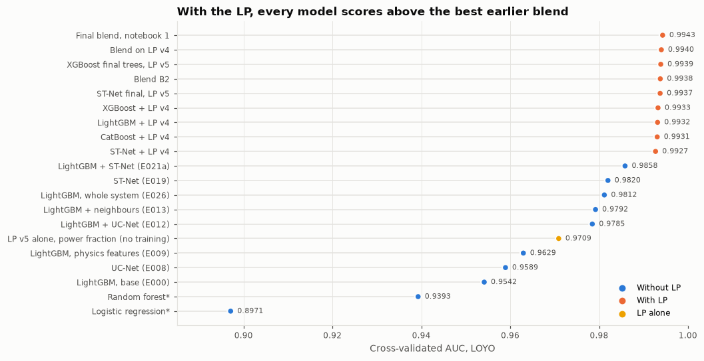
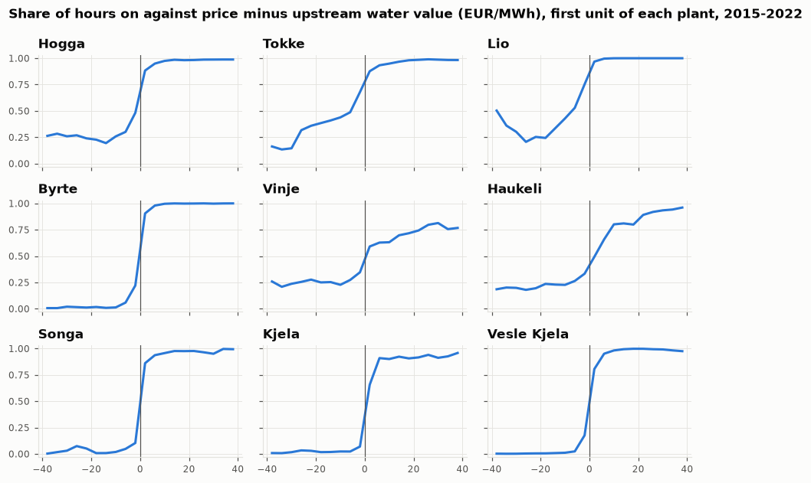
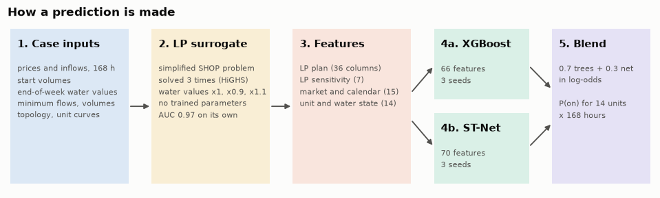
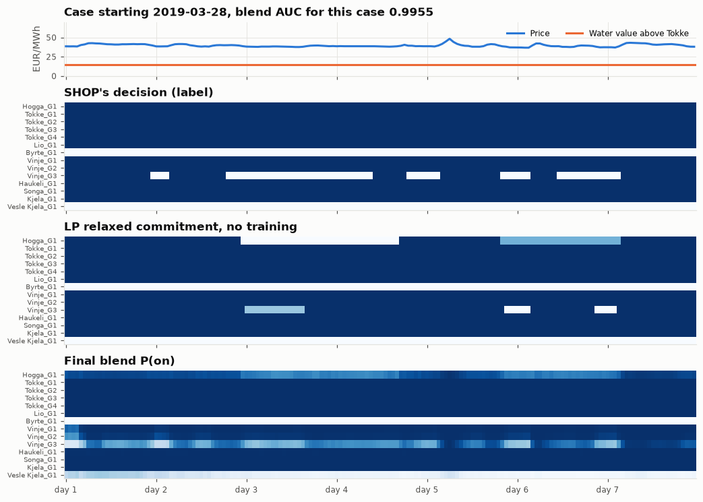
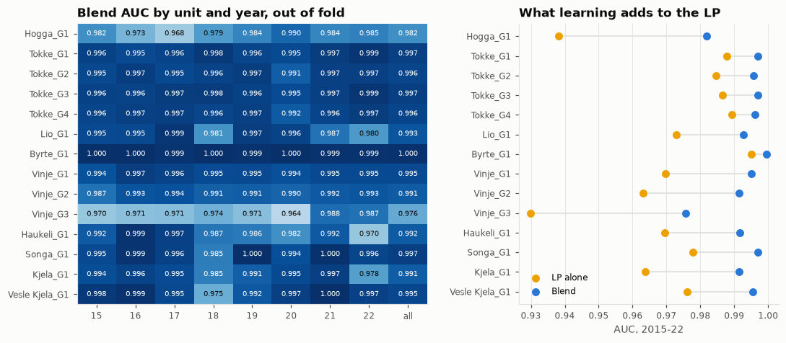

# Predicting hydropower unit commitment with an LP surrogate

Course project in TDT4173 Modern Machine Learning in Practice (NTNU, autumn 2026): a Kaggle competition on data from SINTEF. The task is to predict when each of the 14 generating units in the Tokke-Vinje hydropower system runs, hour by hour, in the weekly plans made by SINTEF's scheduling software SHOP.

**Main idea:** the labels are the output of an optimiser, so instead of asking a model to rediscover the optimisation from data, I solve a simplified version of SHOP's problem as a linear program (LP) and give its plan to the models as features. This one step raised AUC from 0.955 to 0.992 for the same model.

## Results

| Model | Cross-validation, leave one year out (2015-22) | Forward validation (2019-22) | Public leaderboard |
|---|---|---|---|
| **XGBoost + ST-Net on LP v5 features** (final, notebook 1) | **0.99430** | **0.99404** | **0.99651** |
| Same, network without absolute price levels (hedge, notebook 2) | 0.99430 | 0.99408 | 0.99649 |
| Notebook 1 v4: the same model on LP v4 | 0.99400 | 0.99379 | 0.99638 |
| Notebook 2 v4: the same model on LP v4 | 0.99399 | 0.99379 | 0.99635 |
| LightGBM + ST-Net, best without the LP | 0.98584 | - | 0.98906 |
| LP v5 plan alone, no training | 0.9709 | - | - |
| LightGBM, base features | 0.95515 | 0.94877 | - |

Metric: micro-averaged ROC AUC over all unit-hours. Models were selected on cross-validation; the public leaderboard was only a sanity check. LP v5 was accepted before its public scores were known, and they rose by 0.00013-0.00014 against LP v4.

With the LP features, every model type (LightGBM, XGBoost, CatBoost, a neural network) lands within 0.001 of the others and above the best earlier blend. Under regime shifts (for example training on low-price weeks and testing on high-price weeks), models without the LP scored 0.91-0.93 and models with it about 0.99.

## The task

- **Data:** one case per day from 2015 to 2024. Each case is a one-week plan (168 hours) for 17 reservoirs, 9 plants and 14 units (about 1000 MW).
- **Inputs:** hourly prices and inflows, start volumes, water values at the end of the week, minimum flow and volume rules, and the system's topology.
- **Target:** on/off for every unit and hour. Training: 2922 cases (2015-2022). Test: 725 cases (2023-2024), so the models must work in years they have never seen.

A unit should roughly run when the electricity price is above the *water value*, the future worth of the water it uses. The data confirms this, with exceptions caused by minimum flows and spill:

## Approach

**1. LP surrogate of SHOP** (`src/lp_surrogate.py`). For each case, maximise income from selling power plus the value of water left at the end of the week, subject to the water balance in all 17 reservoirs, volume limits, minimum flows and unit power curves. On/off decisions are relaxed to values between 0 and 1, which makes the problem a fast linear program, except for one unit, Lio, whose 168 on/off values are solved as whole numbers first (a few seconds per solve with HiGHS). Flow costs on the main rivers follow the convex cost curve in the system file. It has no trained parameters; the only thing taken from the labels is the start order of identical units.

The key detail was how to value water left in a reservoir. With *telescoping* water values, water in a reservoir is worth its own water value times the energy of the plant below, plus what the same water is worth in the next reservoir down. A plant's margin then nets out to *price minus the water value directly above it*. Two simpler readings gave the LP an AUC of 0.61 and 0.74; telescoping gave 0.93, and later refinements 0.97. The last version (v5) corrected two places where the LP solved a different problem from SHOP: the river cost curves, and a relaxed Lio covering a minimum flow below its minimum output. Its own AUC barely moved, but every model trained on it gained about 0.0004.

**2. Features** (`src/features.py`). The LP is solved three times per case, with water values scaled by 1.0, 0.9 and 1.1. A decision that flips between the solves is a near-tie, where the LP is most likely to disagree with SHOP. Features describe the LP's plan, its marginal cost (from shadow prices), these sensitivities, and market, calendar, unit and water state.

**3. Models.** XGBoost on one row per (case, unit, hour), and ST-Net, a neural network that treats each (unit, hour) as a token, with dilated convolutions over time, attention across units and an output layer that enforces the start order. The final prediction blends them 0.7/0.3 in log-odds. The models learn where SHOP deviates from the LP:

Learning adds most where the LP is weakest:

**Validation.** Leave-one-year-out with a 7-day purge (cases overlap by six days), plus forward validation that trains only on earlier years. A change was accepted only if it beat seed noise (0.0001), improved at least 6 of 8 years and did not hurt forward validation. Each hypothesis was written in the experiment log before the run. The full log is in [`experiments/ledger.md`](experiments/ledger.md) and [`experiments.jsonl`](experiments.jsonl).

## Repository

| Path | Contents |
|---|---|
| [`submission/Report.ipynb`](submission/Report.ipynb) | Full report: EDA, all models tried, interpretation (SHAP, partial dependence, permutation importance), error analysis, robustness and limitations |
| `submission/Short_notebook_1.ipynb`, `Short_notebook_2.ipynb` | Self-contained notebooks that reproduce the two submissions from the raw data |
| `submission/requirements.txt` | Pinned package versions (Python 3.12) |
| `submission/build/` | Sources the notebooks and the report are built from, plus analysis scripts |
| `src/` | Research code: data loading, LP, features, trainers, blending, robustness tests |
| `harness/`, `src/harness.py`, `src/compare.py` | Fixed validation folds and the acceptance rule, protected by hashes in `harness.lock` |

## Reproducing

The competition data is not included. Place the raw files next to a short notebook (they are found by name in any subfolder) or set `UC_DATA_DIR`, install `submission/requirements.txt`, and run the notebook. Measured from an empty directory with 4 cores, a 32 GB limit and no GPU (Xeon 6730P): 3.4-3.8 hours and 17.7 GiB RAM, about half of it in the LP. A second run on the same CPU model gave a byte-identical file.

## Limitations

- The LP's structure, including the two v5 corrections, was chosen by comparing it with labels from all training years, so no year is fully untouched and the validation scores are somewhat optimistic.
- Negative prices make up 2.2 % of test hours but only 0.014 % of training hours. The models react in a sensible direction, but how SHOP reacts cannot be checked without labels.
